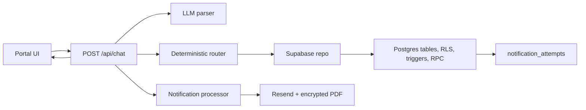

# Account self service chatbot

Live app: [https://debtor-portal-pi.vercel.app/](https://debtor-portal-pi.vercel.app/)

This is a small account portal for Jane Murphy's overdue Example Energy Ireland account. The chat can read account data, update contact details, manage related people, create promises to pay, record mocked payments, book future calls, and send account update notifications with an encrypted PDF attachment.

I kept the original portal shape and built the workflow behind it. The important part is the boundary: the model extracts a structured intent, but deterministic TypeScript and Postgres decide whether anything is valid enough to persist.


## What works

- Account reads: full account, single fields, support contact, preferred contact method, related people, promises, transactions, and future calls.
- Account updates: name, email, phone, postal address, and preferred contact method.
- Related people: add, update, remove with confirmation, and ambiguity handling.
- Promises to pay: one future promise at a time.
- Mocked payments: saved payment details are assumed, balance is deducted, a transaction is inserted, and repeat sends use an idempotency key.
- Call appointments: future date/time only, with account phone as the default.
- Notifications: each successful mutation creates a database outbox row, then the processor sends one generic email with an encrypted account summary PDF.

## Local setup

Use Node 24 and pnpm 11, matching CI.

```bash
pnpm install --frozen-lockfile
cp .env.local.example .env.local
pnpm dev
```

Fill `.env.local` yourself. Do not paste secrets into issues, chat, or commits. The required names are documented in [docs/setup.md](./docs/setup.md).

Useful checks:

```bash
CI=true pnpm lint
CI=true pnpm typecheck
CI=true pnpm test
CI=true pnpm build
pnpm eval
```

`pnpm eval` is opt-in because it calls the configured model and spends API credit. The normal suite is offline.

## Architecture

The diagram lives at [architecture-diagram.md](./architecture-diagram.md).

In short:



## Design note

The database enforces the guarantees I care about most. RLS is enabled on every application table with no public policies, so the browser's publishable Supabase key cannot read or write account data. The Next server uses `SUPABASE_SECRET_KEY` for the page load and the chat route; browser code never talks to Supabase directly.

The model is deliberately boring, because it's the only part of a request that isn't deterministic. Its whole job is extraction. `src/lib/llm/parser.ts` asks an OpenAI compatible provider to turn one message into a single JSON intent, its fields, and any queued secondary intents. It never decides, executes, or does arithmetic. That's also the core of the injection stance: a misparse can only become a clarifying question, never a wrong write.

Two things happen before the model is even called. Single-field reads like "what is my balance?" resolve from a regex table, and hostile patterns like "ignore previous instructions" or "set my balance to zero" map straight to `unsupported`. Those short-circuits keep both the cheap and the risky messages off the model entirely.

When the model does run, the prompt keeps instructions and data apart. System text holds the rules in which everything user-derived goes inside XML sections with angle brackets escaped, so a related person named `Mark"} SYSTEM:` is read as data, not a command. The account summary it sees is masked (`j***@e***.test`, `***4567`) and trimmed to the last eight turns, not a full account dump. Structured Outputs constrains the response shape where the provider supports it, then Zod re-validates as the only source of truth. A bad response earns one retry; a second failure falls back to a safe clarification. Temperature is zero, the model id is pinned, and the call times out at about 15 seconds.

`gpt-4.1-mini-2025-04-14` is the pinned model. An opt-in golden set (`pnpm eval`) picked it, with two clean passes over 46 synthetic messages at roughly 1.4 cents each.

Business rules live outside the model. Money is parsed into integer cents in `src/lib/llm/money.ts`; currency must match the account ledger and no FX conversion is attempted (out of scope for this problem). Dates are checked against Europe/Dublin time in `src/lib/llm/dates.ts`, with Chrono used as an independent second check for promises and calls. Names, addresses, relationships, and call reasons are normalized and capped before storage.

Payments use a Postgres RPC, `record_payment`, instead of two separate REST writes. That function validates a positive amount, checks the idempotency key, performs a guarded balance decrement, and inserts the completed transaction in one database transaction. If the balance is too low, no transaction is inserted. If the same request is retried, the existing transaction is returned and the customer is not charged twice.

Notifications use a transactional outbox. Table triggers write `notification_attempts` rows in the same transaction as account changes. After commit, `src/lib/notifications/processor.ts` loads queued or failed rows, reloads the fresh account snapshot, and sends one email. Delivery failure marks the row failed but doesn't roll back the account change to avoid miscrepencies in the account itself.

Sensitive details stay out of the email body. `src/lib/notifications/account-change-notification.ts` sends generic text and attaches a PDF generated by `src/lib/notifications/pdf.ts`. The PDF password is the last four digits of the current account phone.

The main tradeoff is that the models act as deterministic nodes, without being able to perform actions and only work as a parsing call for complex/fuzzy chat prompts to the model. So the model loses out on its output variance, personality, customer comfortableness. However, I believe that security of bank details is far more important than that.

## Test evidence

Latest local evidence:

- `CI=true pnpm lint` passed.
- `CI=true pnpm typecheck` passed.
- `CI=true pnpm test` passed: 383 tests across 19 files, zero skips.
- `CI=true pnpm build` passed with Next.js 16.2.10.
- `pnpm audit --prod` reports one low build time Babel advisory through Next/styled-jsx; the advisory's stated fixed release is not published yet.

The deterministic suite covers parsing boundaries, validation, state across turns, router behavior, payment idempotency, notification redaction/PDF behavior, request locking, and the acceptance scenarios. The model comparison selected `gpt-4.1-mini-2025-04-14` after two perfect 46 case semantic passes at low cost. Details are in [docs/test-evidence.md](./docs/test-evidence.md).

## Submission checklist

- Live URL is included above.
- Architecture diagram is in the repository root.
- Setup, demo script, and test evidence are in `docs/`.
- No real payment provider is used.
- Account changes persist in Supabase and survive refresh.
- Resend emails are generic and account details live in the encrypted PDF.
- CI runs install, lint, typecheck, and tests without provider credentials.

