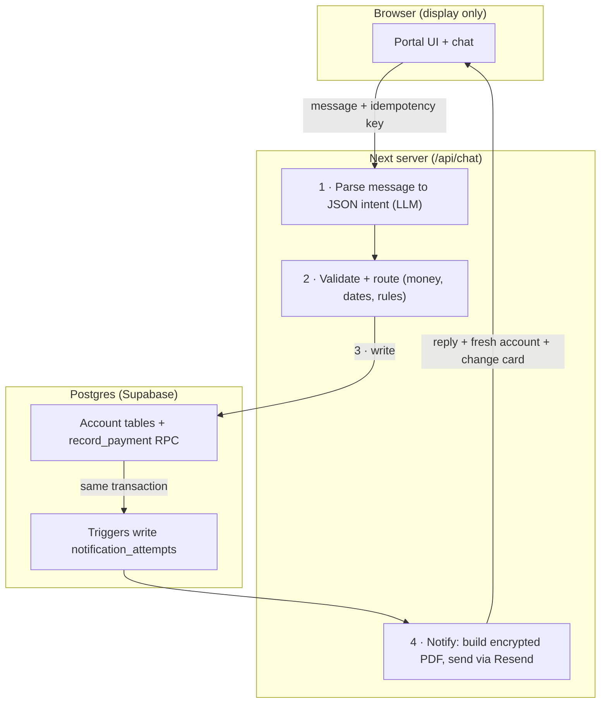
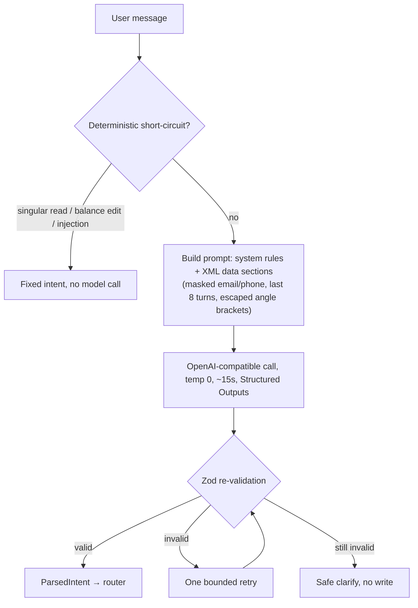

# Architecture diagram

## System flow

One chat message travels through three zones: the browser only displays, the Next server decides, and Postgres holds the invariants. The numbers follow a single request.

Reads skip steps 3 and 4: the router answers from a fresh snapshot and never writes or notifies.

## Message parsing (the LLM boundary)

The model is the one non-deterministic part, so it does the least. It turns free text into a JSON intent and nothing else. Everything after it is code the reviewer can read and test.

Why it's shaped this way:

- The model has no authority. It never decides, executes, or does arithmetic, so a misparse becomes a clarifying question, not a wrong write.
- Cheap and risky messages skip the model entirely. Single-field reads resolve from a regex table, and "ignore previous instructions" or "set my balance to zero" map straight to `unsupported`.
- Account context reaching the model is masked (`j***@e***.test`, `***4567`) and every stored value sits inside XML data sections with angle brackets escaped, so a name like `Mark"} SYSTEM:` reads as data, not instructions.
- Zod is the only source of truth. Structured Outputs constrains the shape when the provider supports it, but the schema check runs either way.

## Trust boundary

The browser owns display and one idempotency key per send attempt. It never queries Supabase.

The model owns extraction only. It returns JSON, not commands. Local validation and the route handlers decide whether an action is allowed.

Postgres owns the invariants that are easiest to get wrong in application code:

- RLS denies public table access.
- Triggers create notification attempts in the same transaction as each mutation.
- `record_payment` deducts balance and inserts the transaction atomically.

Notifications run after commit. If email delivery fails, the account change stays saved and the outbox row records `failed`.
